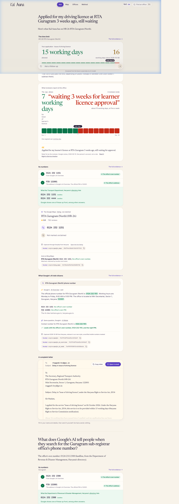
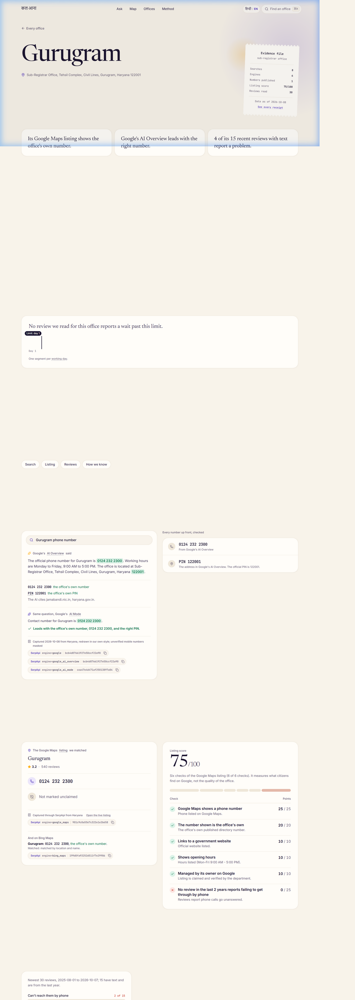
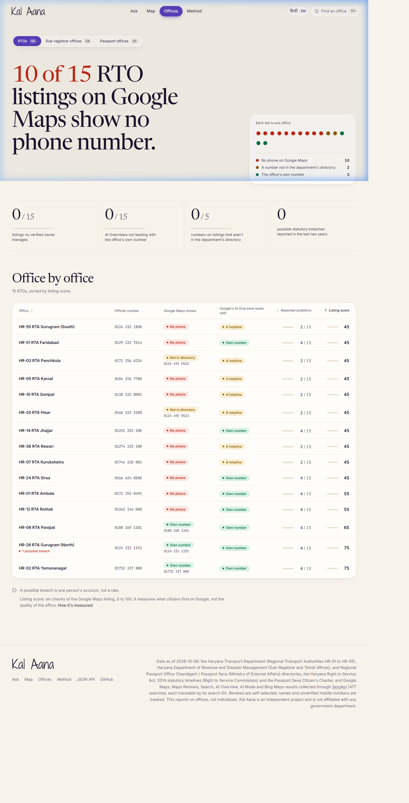
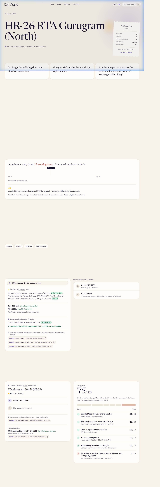
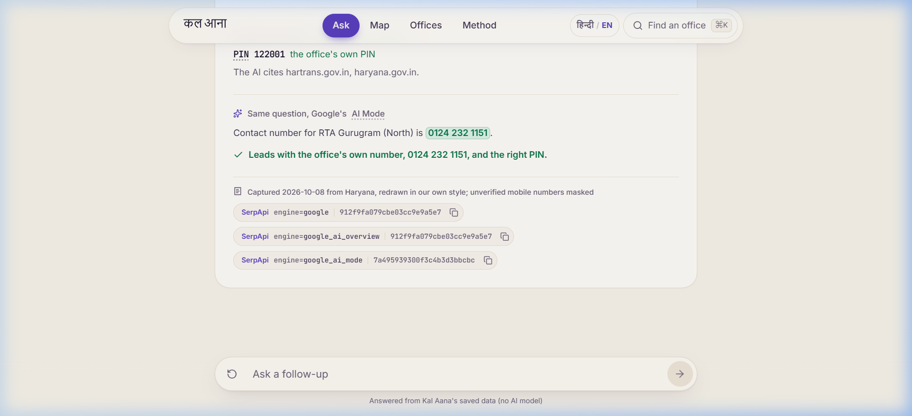

# What it found (Haryana, October 8, 2026)

Every finding for the three office types Kal Aana covers in Haryana, each traceable to the department's directory, a Google Maps listing, a review or a SerpApi search ID.

[Back to README](../README.md)

## RTAs: all 15 Regional Transport Authorities across Haryana

- **The government publishes a landline/phone for all 15 RTAs. On Google Maps, 10 of the 15 RTA listings show no phone number at all**, and 12 of 15 are marked unclaimed (no verified owner manages them).
- **Google's AI Overview did not lead with the office's own number in 6 of the 15 searches where it answered. Asked the same question, Google's AI Mode led with the office's own number in all 15**, with the right PIN wherever it gave one. For RTA Gurugram (North), AI Mode leads with 0124 232 1151.

- **Bing Maps shows the same gap.** Across matched RTAs on Bing, several show no phone or show national portals.
- **Reviewers report phones going unanswered or long delays.** Under the Haryana Right to Service Act, 2014, statutory time limits (e.g. 15 working days for driving licences, 7 working days for learner's licence) are legally mandated, yet reviewers report weeks of waiting.

## Sub-registrar offices: all 28 across Haryana districts

- **The Department of Revenue & Disaster Management, Haryana publishes contact information for all 28 sub-registrar offices. On Google Maps, 18 of the 28 listings show no phone**, and 21 of 28 are unclaimed. A citizen searching Google often encounters agent kiosks or unverified numbers.
- **Google showed an AI Overview for 28 offices searched**, but often leads with state web portals or numbers not verified in the department's official directory.
- **Reviews report middlemen and touts operating near offices.** Citizens report brokers and delay in property deed and registry delivery.

## Passport offices: the Regional Passport Office and Passport Seva Kendras

Passport offices are run by the Ministry of External Affairs, so their time limits come from its Citizen's Charter (counted from complete documentation; fresh passports leave out police verification), backed by national grievance escalations.

- **Most Google Maps listings show national call centres (1800-258-1800) rather than the local centre's direct desk phone.**
- **Private visa and passport agent shops frequently appear near genuine Passport Seva Kendras**, confusing citizens attempting to reach official counters.

## How the claims are sourced

Every claim links to its source: the department's directory, the Haryana Right to Service Commission notification, the Google Maps listing, the review, or the SerpApi search ID. Reviews are self-selected, so the app says "reviewers report", shows sample sizes and date ranges, and says "too few reviews" below 10.

| Report card | Office page | Search comparison in the chat |
|---|---|---|
|  |  |  |

How these numbers were measured: [How it works](method.md). What they can't tell you: [Limitations](ethics.md#limitations).
